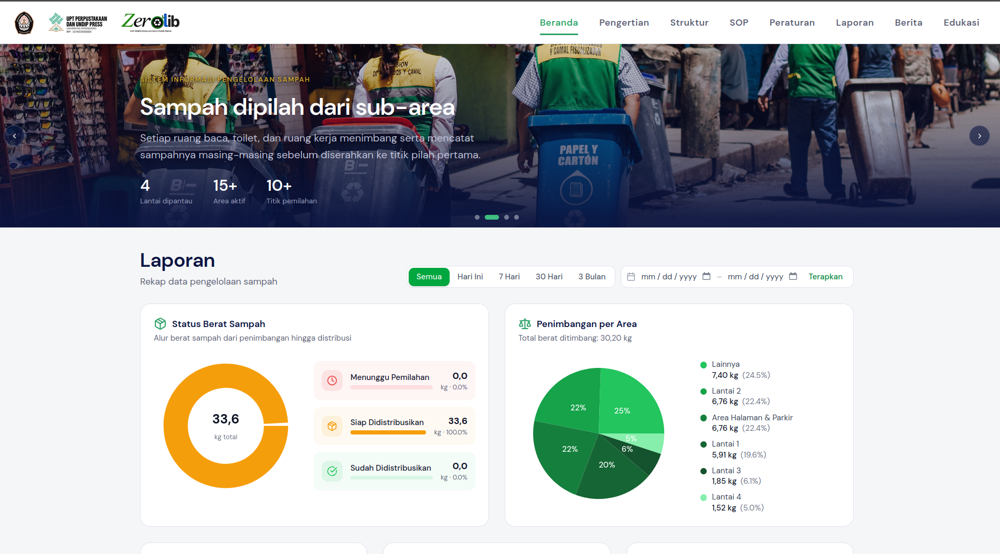
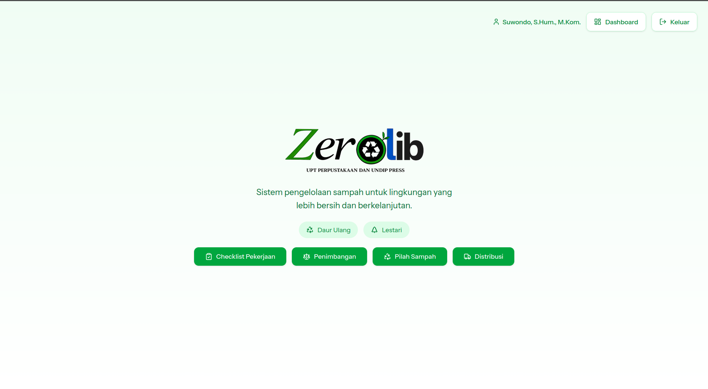

# Zero-Waste Management System

A web platform for structured waste recording, monitoring, and reporting in support of the zero-waste program at **UPT Perpustakaan Universitas Diponegoro**.

| Project | Details |
| --- | --- |
| Type | Collaborative internship project |
| Domain | Waste management and reporting |
| Timeline | July–August 2026 |
| Institution | UPT Perpustakaan Universitas Diponegoro |
| Stack | React, Laravel |
| Repository | Portfolio case study with application source |

## Overview

Zero-Waste Management System is a web application built to support the library's zero-waste program. The interface is branded as **ZeroLib**. It gives staff a structured way to record waste weighing, sorting, and distribution, while providing a public-facing space for program information, educational content, and aggregate reporting.

The application was developed collaboratively by a team during an internship at UPT Perpustakaan Universitas Diponegoro, using React for the frontend and Laravel for the backend.

This repository contains the application source for portfolio review, shared with permission from the project owner. Environment files, credentials, database data, and uploaded media are not included.

## Problem Statement

Waste management activities span multiple floors, rooms, and operational stages. Without a centralized digital record, data from weighing, sorting, and distribution can become fragmented, making it difficult to monitor the flow of waste and prepare consistent reports.

The program also needs a reliable place to publish reference information such as its structure, standard operating procedures, rules, news, and educational material. Visitors and staff need a shared view of progress without relying on scattered records.

## Solution

The system connects a public information and reporting experience with a role-based operational dashboard:

- Staff record waste weighing, sorting, and distribution through structured forms.
- Administrators review distribution records and manage reference data, tasks, accounts, and published content.
- Recorded data is aggregated into charts and tables for monitoring waste flow by stage, area, type, and destination.
- Public pages present program information, documents, news, educational posters, and aggregate reports.

The project supports the institution's zero-waste program. It does not, by itself, claim that zero waste has been achieved or that verified environmental outcomes have been produced.

## Screenshots

### Public Landing Page and Reports



*Public-facing page with program information, navigation, date filters, and charts for waste weight status, weighing by area, sorting, and distribution. The values shown reflect the captured environment and are not presented as verified outcomes.*

### Staff Dashboard



*Authenticated staff home page with shortcuts for work checklists, weighing, waste sorting, and distribution.*

## Key Features

### Public information and reporting

- Landing page covering the program's purpose, structure, SOP, rules, news, and educational content.
- Reports dashboard with period presets, a custom date range, and charts for waste status by stage, weighing by area, sorted waste by type, distribution by destination, and remaining or ready-to-distribute material.
- Published PDF documents for program information such as structure, SOP, and rules.
- News and educational poster sections with publishing controls in the admin area.
- Area feedback and review with ratings, comments, filters, and aggregate rating summaries.

### Staff and administration

- Role-based access for administrators and operational staff.
- Waste weighing records with date, area, waste type, and weight, including list, edit, delete, and CSV export.
- Waste sorting records with date, waste type, and weight, including CSV export.
- Distribution records with destination and location, plus an admin review workflow covering pending, approved, needs-revision, and rejected states.
- Daily, weekly, and monthly work checklists with per-officer progress, history, and CSV export.
- Admin dashboard with waste-flow charts, staff activity summaries, and date filters.
- Management of accounts, master tasks, reference data, documents, news, posters, and area reviews.

## Technology Stack

| Layer | Technology |
| --- | --- |
| Frontend | React, TypeScript |
| Backend | Laravel (PHP) |
| Frontend–backend integration | Inertia.js |
| Styling and UI | Tailwind CSS, Radix UI |
| Charts | Recharts |
| Authentication | Laravel Fortify |
| Database | MySQL |
| Build tooling | Vite |

Only technologies verified from the project are listed.

## Getting Started

### Prerequisites

- PHP 8.3 or later
- Composer
- Node.js and npm
- MySQL

### Local setup

```bash
composer install
cp .env.example .env
php artisan key:generate

# Configure the MySQL database in .env, then create the `zero_waste` database.
# Set SEED_DEMO_PASSWORD in .env before seeding to create the demo accounts.
php artisan migrate --seed
php artisan storage:link

npm install
npm run build
php artisan serve
```

When `SEED_DEMO_PASSWORD` is set, the demo administrator account uses `admin@example.test` and the staff accounts use `staff1@example.test` through `staff5@example.test`. `AkunSeeder` skips account creation when the password is empty.

The original database, uploaded documents and images, and environment credentials are not included. The commands above create a fresh local database from the included migrations and seeders.

## My Contributions

As a member of the development team, I contributed across the frontend and backend of the application:

- Collaborated with team members to develop the web-based waste management system using React and Laravel.
- Contributed to the implementation and refinement of application features across both the frontend and backend.
- Worked closely with the team to integrate components, resolve technical issues, and improve overall application functionality.

## Team Project Context

This was a collaborative internship project at UPT Perpustakaan Universitas Diponegoro from July to August 2026. I worked as a collaborator on a private repository owned by another party.

The application source is included with permission from the project owner for portfolio review. Ownership remains with the original owner. Environment files, credentials, the original database, uploaded media, and the original Git history are not included.

Screenshots and seed data are included for documentation and demonstration purposes. Institution names and logos, as well as third-party materials shown in the application, remain the property of their respective owners.

## Project Status

**Status:** Completed internship project (July–August 2026).

This repository contains the application source for portfolio review, along with documentation and screenshots. No public demo is linked. Ownership of the original application remains with the project owner, and this is not the official project repository.
